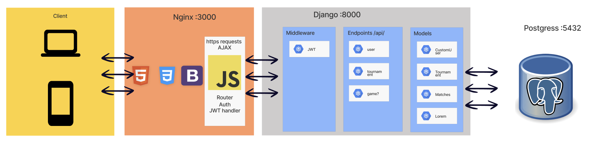

# Pixel Pong Transcendence

A full-stack Pong platform built as a Single Page Application with real-time multiplayer, tournaments, account management, and an optional terminal client.

<p align="center">
  
</p>

## Highlights

- Real-time online Pong using WebSockets (Django Channels + Daphne + Redis)
- Local game modes: 1-player (AI) and 2-player
- Tournament creation, joining, and live tournament flow
- JWT auth, 2FA (TOTP + QR), and OAuth (42 Intra)
- Profiles, avatars, friend system, invites, and match history
- ELO updates after matches
- Optional curses-based CLI client

## Tech Stack

- Frontend: HTML, CSS, JavaScript, Bootstrap
- Backend: Django, Django Channels, Daphne
- Realtime: WebSockets + Redis
- Database: PostgreSQL
- Infra: Docker, Docker Compose, Nginx, Makefile
- Optional client: Python curses CLI

## Architecture Snapshot

<p align="center">
  
</p>

## Repository Structure

```text
.
├── frontend/      # SPA pages, router, game UI, lobby/tournament handlers
├── backend/       # Django API, auth, tournament models/views, ws consumers
├── nginx/         # Reverse proxy + TLS setup + env injection for frontend
├── CLI/           # Terminal client (curses) with HTTP/WebSocket networking
├── python-pong/   # Standalone pong engine utilities
├── docker-compose.yml
└── Makefile
```

## Quick Start (Docker)

### 1. Create `.env`

Create a `.env` file at repo root:

```env
POSTGRES_DB=transcend
POSTGRES_USER=transcend
POSTGRES_PASSWORD=transcend
POSTGRES_HOST=db
POSTGRES_PORT=5432

JWT_SEED=change-this-jwt-seed

# For CORS / frontend auth flow
FRONTEND_URL=https://localhost:3000

# Injected into frontend/srcs/utils/utils.js by nginx/setup.sh
DJANGO_BACKEND_URL=https://localhost:3000
DAPHNE_URL=wss://localhost:3000

# Optional (needed for 42 OAuth flow)
INTRA_CLIENT_ID=
INTRA_CLIENT_SECRET=
INTRA_REDIRECT_URI=https://localhost:3000/intra
```

### 2. Build and run

```bash
make up
```

### 3. Open the app

- Web app: `https://localhost:3000`
- API through nginx: `https://localhost:3000/api/...`
- Django admin through nginx: `https://localhost:3000/admin`

Note: Nginx generates a self-signed certificate in this setup, so your browser will show a TLS warning locally.

## Useful Commands

```bash
make up       # build + start
make down     # stop
make restart  # restart services
make status   # docker status overview
make clean    # remove containers, volumes, images for this stack
```

## Optional: Run the CLI Client

```bash
cd CLI
make install
make run
```

The CLI reads `CLI/config.json` (`localhost:8000` / `ws://localhost:8001` by default).

## WebSocket Endpoints

Proxied via nginx under `https://localhost:3000/ws/...`:

- `/ws/lobby/`
- `/ws/pong/<match_id>/`
- `/ws/pong2/<match_id>/`
- `/ws/tournament/<tournament_id>/`

## Team

- [@andresmejiaro](https://github.com/andresmejiaro)
- [@MatPizzolo](https://github.com/MatPizzolo)
- [@Splix777](https://github.com/Splix777)
- [@HakimHC](https://github.com/HakimHC)
- [@adrgonza](https://github.com/adrgonza)

## Image Credits

README visuals are reused from teammate repositories and credited here:

- Gameplay GIF: `MatPizzolo/ft_transcendence` (`readme-tools/trascend-whole-vid.gif`)
- Architecture diagram: `andresmejiaro/transcend` (`readme_documentation/attach-files/Arquitecture_trascendence.png`)
